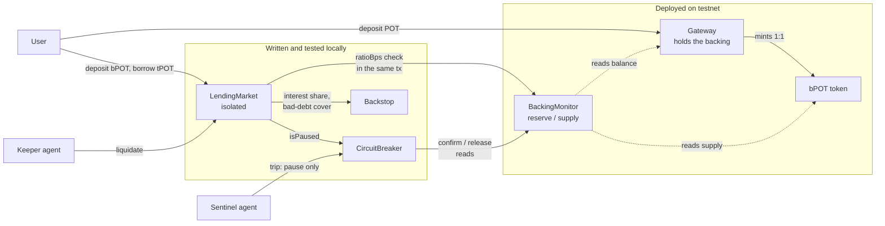
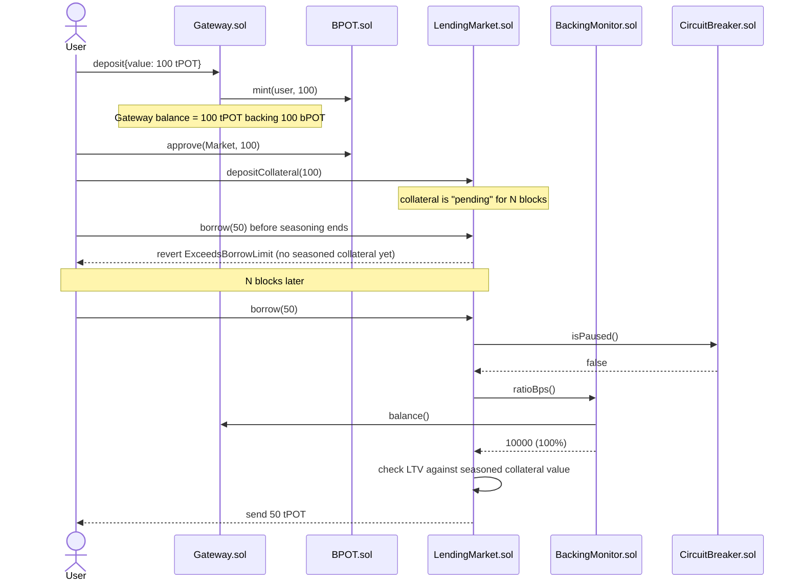
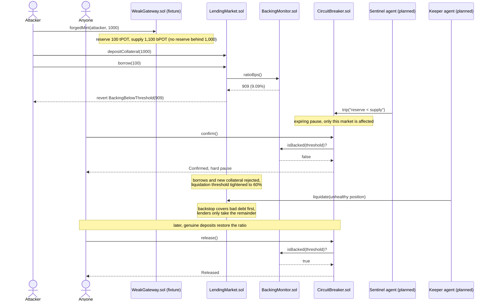

# DotProof — Backing-Aware Lending on Portaldot

> **The first lending protocol on Portaldot where every borrow is checked, on-chain and inside the same transaction, against proof that the collateral is actually backed — and where a bonded agent network can only ever make the system safer.**

> Built for Portaldot Hacker House 2026 (Ecosystem DApps track). Unaudited hackathon prototype on the V3 testnet. Testnet tokens have no value.

---

## The Problem in One Sentence

Lending protocols judge collateral by **market price and governance review**, not by **whether it is still backed**, so a forged or buggy mint can be deposited and borrowed against before anyone can react.

---

## Why This Matters — The KelpDAO / Aave Incident (April 2026)

| Figure | Detail | Source |
|---|---|---|
| **$292M** | Stolen in the KelpDAO bridge exploit (Apr 18, 2026) | [Unchained](https://unchainedcrypto.com/aave-faces-up-to-230-million-in-losses-after-kelp-dao-exploit-incident-report-finds/) |
| **116,500** | Unbacked rsETH released by a forged cross-chain message | [CoinDesk](https://www.coindesk.com/tech/2026/04/20/aave-could-face-up-to-usd230-million-in-losses-after-kelp-dao-bridge-exploit-triggers-defi-chaos) |
| **89,567** | rsETH deposited as Aave collateral across seven wallets | [Unchained](https://unchainedcrypto.com/aave-faces-up-to-230-million-in-losses-after-kelp-dao-exploit-incident-report-finds/) |
| **~$190M** | WETH and wstETH borrowed against it, on Ethereum and Arbitrum | [Unchained](https://unchainedcrypto.com/aave-faces-up-to-230-million-in-losses-after-kelp-dao-exploit-incident-report-finds/) |
| **$123.7M – $230.1M** | Aave bad-debt estimate range (loss spread across all holders vs confined to L2s) | Unchained, CoinDesk |
| **100%** | WETH pool utilization after the run, which froze withdrawals | [Unchained](https://unchainedcrypto.com/aave-faces-up-to-230-million-in-losses-after-kelp-dao-exploit-incident-report-finds/) |
| **~$2B, 69%** | Stolen from cross-chain bridges in 2022 (Chainalysis, as of Aug 2022): 69% of all stolen funds across 13 hacks. *Dated figure.* | [CryptoSlate](https://cryptoslate.com/chainalysis-reports-2b-lost-in-cross-chain-bridge-hacks/) |

Outflow figures after the incident differ by source and by what they measure ($6B to $10B), so we do not rely on a single number. Aave's own report found its contracts functioned as designed. The gap is structural: nothing checked the backing.

---

## Three Layers of the Problem

### 1. Backing Breaks Silently
A forged or buggy mint creates tokens that look normal on price feeds until the market reacts. A price feed can't tell you that the reserve behind a token is gone.

### 2. Reaction Is Slow and Narrow
Freezes depend on a governance guardian or on an asset-specific feed existing and being enabled. In KelpDAO the attacker borrowed *before* Aave's markets were frozen. If mint and borrow happen atomically in one transaction, **no off-chain bot can stop them**. Only a check inside the borrow transaction can.

### 3. Damage Spreads
In a shared pool, one bad collateral creates bad debt that hits unrelated lenders. After the incident, WETH pools hit 100% utilization and lenders could not withdraw.

---

## The Solution — DotProof

DotProof is an **isolated-market** lending protocol. Each collateral asset gets its own market. Before any borrow, the market runs a **synchronous on-chain backing check**. Autonomous agents with their own wallets, hard permission limits and slashable bonds watch what the chain cannot see, and can only tighten the system.

```
Without a backing check (today's lending):
  borrow(amount)
  → checks: price feed, LTV, caps
  → collateral that is 61% backed still "looks" fully priced
  → borrow succeeds, loss lands on lenders

With DotProof:
  borrow(amount)
  → BackingMonitor.ratioBps()  = reserve / supply, read on-chain, same transaction
  → ratio < 99.5%  →  revert BackingBelowThreshold(ratio)
  → seasoning:     fresh collateral can't back a loan for N blocks
  → isolation:     only this market pauses, every other market keeps running
```

### Principles
1. **No simulated data.** Every price, reserve and attestation comes from real on-chain state or real RPC reads. Testnet tokens are valueless by nature, but no logic is faked.
2. **AI proposes, contracts dispose.** Safety-critical decisions are deterministic contract logic. Agents can only tighten, never loosen.
3. **Isolation by default.** One bad collateral must not contaminate other markets.
4. **Honest trust model.** Where trust is required (cross-chain attestation), it is documented, bonded and limited.

### Valuation Without a Price Oracle
Collateral (bPOT) and the borrow asset (native tPOT) are both POT-denominated, so collateral value is simply `amount × backing ratio × 1 POT`. No external price feed, nothing that can be manipulated or faked.

---

## What Makes DotProof Unique

| Protocol | Backing check at borrow | Scope of a freeze | Needs per-asset feed + governance | Loss cover | Where it is today |
|---|---|---|---|---|---|
| **Aave Proof of Reserve** | ❌ Flags after the fact, then an executor freezes | ❌ Reserve-wide (V2 executor also disables borrowing for all pool assets) | ✅ Chainlink feed per asset + governance enablement | ❌ | Live on Avalanche for 5 assets |
| **Aave Umbrella** | ❌ | n/a | n/a | ✅ Staker slashing, **after** the loss, 20-day cooldown | Live |
| **Morpho Blue** | ❌ None described | ✅ Isolated markets | Immutable per-market oracle | ❌ None described | Live |
| **Euler v2** | ❌ None described | ✅ Isolated vaults | n/a | ⚠️ Opt-in per vault | Live |
| **DotProof** | ✅ In the borrow transaction | ✅ One market only | ❌ No feed for assets we mint | ✅ Pre-funded backstop per market | Testnet prototype |

> Aave PoR and Umbrella rows come from the [Aave Proof of Reserve repo](https://github.com/aave-dao/aave-proof-of-reserve) and [Umbrella docs](https://aave.com/docs/aave-v3/umbrella). Morpho and Euler rows come from third-party overviews and should be verified against their official docs before being cited externally.

**Three capabilities this combination brings:**
1. **Borrow-time backing check**: the market itself refuses the borrow, so an atomic mint-and-borrow can't slip past an off-chain monitor.
2. **A breaker that can only tighten**: a sentinel can pause, anyone can confirm a pause with an on-chain proof, nobody (not even the owner) can unpause by decree.
3. **A reusable primitive**: `BackingMonitor` works for any Portaldot token whose backing is held as native currency by one reserve.

### Where DotProof Is *Not* Better
Liquidity, audits, battle-testing and price-oracle coverage. This is a hackathon prototype. Cross-chain backing in the design still depends on agent attestation, which is a trust assumption, not a trustless proof.

---

## Technical Architecture

### System Overview

```
┌──────────────────────── User / Browser ──────────────────────────┐
│  Next.js frontend (React 19, Tailwind)                            │
│  Landing page, markets, agents, app shell                         │
│  Status: built, data is placeholder until wired to the contracts  │
└───────────────────────────────────┬──────────────────────────────┘
                                    │  eth JSON-RPC
                                    ▼
┌────────────────── Portaldot V3 testnet (pallet-revive EVM) ──────┐
│                                                                   │
│  Gateway.sol                                  [deployed]          │
│  ├─ deposit()  → mints bPOT 1:1 against native POT it holds       │
│  ├─ withdraw() → burns bPOT, releases POT                         │
│  └─ the Gateway's own balance IS the reserve                      │
│                                                                   │
│  BPOT.sol                                     [deployed]          │
│  └─ minimal ERC-20, only the Gateway can mint or burn             │
│                                                                   │
│  BackingMonitor.sol                           [deployed]          │
│  └─ ratioBps() = reserve balance / bPOT supply, capped at 100%    │
│                                                                   │
│  LendingMarket.sol                            [tested locally]    │
│  ├─ supply / withdrawSupply  (share-based, interest accrues)      │
│  ├─ depositCollateral / withdrawCollateral                        │
│  ├─ borrow()  → BackingMonitor.ratioBps() check, same tx          │
│  ├─ seasoning: new collateral waits N blocks                      │
│  ├─ repay() / liquidate()  (bonus, bad-debt write-off)            │
│  └─ caps: supply, borrow, collateral                              │
│                                                                   │
│  CircuitBreaker.sol                           [tested locally]    │
│  ├─ trip()    sentinel only, expiring pause                       │
│  ├─ confirm() anyone, when BackingMonitor proves under-backing    │
│  └─ release() anyone, only once backing is restored               │
│                                                                   │
│  Backstop.sol                                 [tested locally]    │
│  └─ first-loss reserve, funded by a share of interest             │
│                                                                   │
│  WeakGateway.sol  (EXPLOIT REPRODUCTION FIXTURE, not a bridge)    │
│  └─ forgedMint() creates bPOT with no reserve behind it           │
└───────────────────────────────────────────────────────────────────┘
        ▲                                         ▲
        │ trip(): pause only                      │ liquidate()
   Sentinel agent                            Keeper agent
   [planned]                                 [planned]
```



---

## How the Safeguards Work

### 1. Synchronous Backing Check (`LendingMarket.borrow`)

```solidity
uint256 ratio = monitor.ratioBps();
if (ratio < params.minBackingBps) revert BackingBelowThreshold(ratio);
```

`BackingMonitor.ratioBps()` returns `reserve balance × 10,000 / supply`, capped at 100%, and treats an empty supply as fully backed. The check runs in the same transaction as the borrow.

### 2. Collateral Seasoning

New collateral sits in a `pending` bucket and only joins `seasoned` collateral after `seasoningBlocks`. Only seasoned collateral counts toward borrowing power. Each new deposit restarts the clock for the whole pending bucket, which is deliberately conservative.

### 3. Collateral Valuation Follows the Live Ratio

```solidity
function valueOf(uint256 amount) public view returns (uint256) {
    return (amount * monitor.ratioBps()) / BPS;   // no oracle
}
```

If backing falls, collateral value falls with it, positions become liquidatable on their own, and health factors reflect reality without any feed.

### 4. A Circuit Breaker That Can Only Tighten

| Action | Who | What it does |
|---|---|---|
| `trip(reason)` | Whitelisted sentinel | Time-limited pause. **Lapses on its own** unless confirmed |
| `confirm()` | Anyone | Promotes to a hard pause, **only if** `BackingMonitor` shows under-backing |
| `release()` | Anyone | Lifts a hard pause, **only once** backing is restored |
| unpause by decree | **Nobody** | Not possible, not even for the owner |

While paused, the market rejects new borrows and new collateral, and the liquidation threshold tightens (80% to 60% in the test configuration) so bad positions are cleared sooner. Repay, liquidate and lender withdrawals keep working.

### 5. Backstop
A configurable share of interest (10% in tests) accrues to the Backstop. On bad debt, the market draws from it first and only then reduces lenders' assets.

### 6. Exploit Reproduction Fixture
A correct wrapped token never goes unbacked, so a breaker would never fire. `contracts/contracts/fixtures/WeakGateway.sol` adds a deliberately weak privileged mint (`forgedMint`) mirroring how the KelpDAO attacker minted unbacked tokens. It exists only so the monitor and breaker have something real to catch. **It is a demo fixture, not a production bridge**, and is labelled as such in code and docs.

---

## The Same Attack Against DotProof — Sequence Diagrams

> This is how the system behaves in the automated tests (see "What the Tests Cover"). It is not a mainnet result.

### Honest Mint and Borrow



### Forged Mint: Borrow Reverts, Breaker Trips



---

## Agent Network (Planned)

Each agent has its own wallet (pays its own gas), a registered identity, role-limited permissions enforced by contracts, and a slashable bond.

| Agent | Job | Earns | Loses bond if | Can | Cannot |
|---|---|---|---|---|---|
| **Sentinel** | Reads source-chain reserves and mint/borrow patterns, flags danger | Reward when danger is confirmed | It raises false alarms | Pause one market, lower caps, post incident reports | Unpause, raise caps, move funds |
| **Keeper** | Liquidates unhealthy loans (permissionless, anyone can run one) | Liquidation bonus | It acts outside its limits | Liquidate | Anything else |
| **Guardian** *(stretch)* | Protects a user's position within their allowance | Small fee | It overspends | Spend up to the user's allowance | Exceed it or touch other accounts |

**Status:** the contract side that agents act on (`CircuitBreaker.trip`, `LendingMarket.liquidate`) exists and is tested, with sentinels held in an owner-managed list. `AgentRegistry` (bonds, rewards, slashing) and the agent bots themselves are **not built yet**.

**Decision logic:** rule-based by default. An LLM may assist a Sentinel on borderline cases and log its reasoning, with rules as the fallback, and it never has authority over safety-critical paths.

**Honest note:** a plain script can read real chain data and apply thresholds just as well. The value of the "agent" framing is accountability and autonomy (own identity, wallet, bond, limits, earnings), not that an LLM is required.

---

## Why Portaldot

- The ecosystem's stated focus on RWA tokenization and contract security fits a backing-check layer. (Portaldot's performance, quantum and AI claims are unverified and are not cited here.)
- V3 accepts Solidity through `pallet-revive`, so the contracts run there as plain EVM bytecode.
- **Ecosystem contribution:** `BackingMonitor` is reusable by any token on Portaldot, including future bridged assets. Integrations with iBridge, iSwap or a cross-chain oracle will be claimed only after their testnet availability is confirmed.

### Measured Findings About the Network (useful to other builders)

Measured against the live chain while building:

| Finding | Value | Consequence |
|---|---|---|
| EVM implementation | `pallet-revive`, `allowEVMBytecode = true`, RPC identifies as `eth-rpc` | Plain `solc` bytecode deploys directly. No `resolc` needed |
| Code storage deposit | `depositPerByte = 6e12` ≈ **0.06 tPOT per byte** of contract code, plus a fixed per-contract deposit | Bytecode size is a real cost. A dry-run quote for the full 7-contract set is roughly 1,000 tPOT |
| PolkaVM (`resolc`) build size | ~7× larger than EVM bytecode (`LendingMarket` 72 KB vs ~8 KB) | We deploy EVM bytecode |
| Decimals | `nativeToEthRatio = 10000`: 14 native decimals appear as 18 on the EVM side | Contracts assume 1e18 per tPOT |
| Account mapping | `autoMap = true`. An EVM `0x` address maps to the SS58 address `<20 bytes><12 × 0xEE>` | EVM wallets can be funded from a native account |

These findings shaped the code: bPOT is a minimal hand-written ERC-20, and the Reserve is merged into the Gateway, to save deposit.

---

## Live on Portaldot V3 Testnet

Network `PortaldotV3 Test` · EVM chain ID `420420777` · RPC `https://test-evm-rpc-v3.portaldot.dev` · node console `https://node-console.portaldot.dev/`

> Check-in slice deployed. Deployer: `0xba8212D81868EB497FF67263761B774EFC413179`. Addresses and hashes are also in [`contracts/deployments/portaldot.json`](contracts/deployments/portaldot.json).

### Deployed Contracts

| Contract | Address | Code on-chain |
|---|---|---|
| Gateway (also the reserve) | `0x619cA0F74Bbe92CaE32CA72920CbA0ff0E5aF370` | 1,055 bytes |
| bPOT | `0xF8191413d53B750cE2F0BFc44722c0EBF0bF95A1` | 1,884 bytes |
| BackingMonitor | `0x60A22c14e7c3353d5B26843c8eA1cFF5D12Ef589` | 828 bytes |

### Transactions

| Transaction | Hash | Block |
|---|---|---|
| Deploy Gateway (creates bPOT) | `0x2b6ea71cc1f2e36e5bd01ab240149b425af2f13fe0381105102b5f345ed06651` | 162329 |
| Deploy BackingMonitor | `0x3eca706625c37f8308782f41c9b71d08256b1ab2e312e2e0163410854c804278` | 162330 |
| Demo deposit (1 tPOT → 1 bPOT) | `0x8c0fd8f59613050537c223e881833c248735707e7af983d8bcfd23f53d978040` | 162331 |

After the demo deposit, `BackingMonitor.ratioBps()` returns `10000` (100% backed) and the Gateway holds 1 tPOT of backing for 1 bPOT of supply.

To verify any hash without an explorer, call `eth_getTransactionReceipt` against the RPC above (status `0x1` means success).

### Not Yet Deployed

`LendingMarket`, `CircuitBreaker`, `Backstop` and the `WeakGateway` fixture are written and tested but not on the testnet. Their code deposits need roughly 700 tPOT more than the check-in wallet held, so they are waiting on additional testnet tokens.

---

## Project Status

| Item | State |
|---|---|
| Gateway, bPOT, BackingMonitor on testnet with real tx hashes | ✅ Done |
| LendingMarket, CircuitBreaker, Backstop, exploit fixture | ✅ Written, 18 passing tests · ⏳ not yet deployed |
| Frontend: live backing ratio, reserve, supply and block on the landing page and `/app`; wallet connect, **mint and redeem through the deployed Gateway** | ✅ Wired to the testnet contracts (viem) |
| Frontend: markets list, market detail (except the bPOT gauge), agents page, borrow and repay | ⚠️ Placeholder data, because `LendingMarket` and the agents are not deployed yet |
| MarketFactory | ⏳ Not started |
| AgentRegistry (bonds, rewards, slashing) | ⏳ Not started |
| Sentinel and Keeper agents running against real RPC data | ⏳ Not started |

---

## Repository Structure

```
DotProof/
├── contracts/                  # Hardhat project, all Solidity
│   ├── contracts/
│   │   ├── Gateway.sol                  # Mint/burn bPOT, holds the backing
│   │   ├── BPOT.sol                     # Minimal ERC-20, Gateway-controlled
│   │   ├── BackingMonitor.sol           # reserve / supply, on-chain
│   │   ├── LendingMarket.sol            # Isolated market (core)
│   │   ├── CircuitBreaker.sol           # Pause that can only tighten
│   │   ├── Backstop.sol                 # First-loss reserve
│   │   └── fixtures/WeakGateway.sol     # EXPLOIT REPRODUCTION FIXTURE
│   ├── test/DotProof.test.js            # 18 tests incl. the KelpDAO-style attack
│   ├── scripts/
│   │   ├── deploy-slice.js              # Check-in slice deploy (dry-run mode included)
│   │   ├── deploy.js                    # Full-system deploy (when funded)
│   │   └── demo-slice.js                # Live backing-state demo
│   └── deployments/portaldot.json       # Live addresses and tx hashes
│
└── web/                        # Next.js frontend
    ├── app/                     # /, /markets, /markets/[id], /agents, /app
    ├── components/              # Nav, Footer, landing sections
    └── lib/placeholder.ts       # Placeholder data, isolated for easy replacement
```

---

## Tech Stack

| Layer | Technology |
|---|---|
| Smart contracts | Solidity 0.8.24 (`paris` EVM target), Hardhat |
| Libraries | OpenZeppelin Contracts 5.x (`Ownable`, `ReentrancyGuard`, `SafeERC20`, `IERC20`) |
| Chain | Portaldot V3 testnet (`pallet-revive` EVM, chain ID 420420777) |
| Frontend | Next.js 15, React 19, TypeScript, Tailwind CSS 4, viem 2 (injected wallet, MetaMask) |
| Planned | Sentinel and Keeper bots (Node.js) |

---

## Local Setup

### Prerequisites

- Node.js 20+ (developed on Node 24)
- For testnet deployment: an EVM wallet funded with testnet tPOT (see below)

### Install

```bash
cd contracts && npm install
cd ../web && npm install
```

### Run the Tests

```bash
cd contracts
npx hardhat test          # 18 tests on a local Hardhat chain, no key needed
```

### Run the Frontend

```bash
cd web
npm run dev               # http://localhost:3000
```

> Don't run `npm run build` while `npm run dev` is running; both write to `.next` and the dev server will break until you delete `.next` and restart.

### Environment

**`.env`** at the repo root (git-ignored, never commit it):

```env
DEPLOYER_KEY=<testnet-only private key, no real funds>
# PORTALDOT_RPC=https://test-evm-rpc-v3.portaldot.dev   (optional override)
```

Use a throwaway wallet that holds only testnet tokens. The deploy script refuses to run if the key does not belong to the expected deployer address.

### Get Testnet Tokens

Testnet tPOT is distributed by the Portaldot team. Request tokens in the [Portaldot Discord](https://discord.gg/portaldot) with a **native** address (starts with `5`), not a `0x` address. To fund an EVM wallet, transfer from a native account to the wallet's mapped SS58 address (`<20-byte 0x address><12 × 0xEE>` encoded with prefix 42) using `balances.transferKeepAlive`.

### Deploy to the Testnet

```bash
cd contracts
DRY_RUN=1 npx hardhat run scripts/deploy-slice.js --network portaldot   # estimate cost, sends nothing
npx hardhat run scripts/deploy-slice.js --network portaldot             # real deployment
```

---

## End-to-End Test Flow

1. **Run the suite:** `cd contracts && npx hardhat test` and watch the 18 tests pass.
2. **See the live deployment:** `npx hardhat run scripts/demo-slice.js --network portaldot` prints the addresses, the reserve held, the bPOT supply and the backing ratio read from the testnet, with no key needed.
3. **Mint on camera:** `DEPOSIT=0.1 npx hardhat run scripts/demo-slice.js --network portaldot` (needs `DEPLOYER_KEY`). Supply and reserve rise together and the ratio stays at 100%.
4. **Replay the attack locally:** the test `synchronous backing check reverts the attacker's borrow` forges 1,000 unbacked tokens against 100 real reserve and asserts the borrow reverts with `BackingBelowThreshold(909)`.
5. **See the breaker:** the tests `the breaker confirms permissionlessly, pauses only the affected market, and tightens liquidation` and `only sentinels can trip, a soft trip expires, and release needs restored backing` cover the full pause lifecycle.

6. **Use the browser app:** `cd web && npm run dev`, open `/app`, connect MetaMask (the app adds the Portaldot testnet for you), then **Mint** tPOT into bPOT and **Redeem** it back. The landing page's "Live on Portaldot testnet" strip and the `/app` gauge read `BackingMonitor` directly from the chain.

> Borrow and repay in the browser are not available yet, because `LendingMarket` is not deployed. Those tabs say so. The markets list, agents page and market details other than the bPOT gauge still show placeholder data.

---

## What the Tests Cover

- **Gateway and monitor:** mint and redeem 1:1, only the Gateway can mint, and a forged mint drops the ratio (100 real + 60 forged = 62.5%).
- **Seasoning and limits:** an immediate borrow fails, then succeeds after seasoning. LTV limit, collateral withdrawal that would break LTV, supply cap.
- **Interest:** accrual over a year, backstop share routed on flush, full repayment with refund of any overpayment, lender withdrawal with interest.
- **Liquidation:** healthy positions can't be liquidated, unhealthy ones can with the bonus, and bad debt is covered by the backstop first, then lenders.
- **The KelpDAO pattern:** an attacker forges 1,000 unbacked tokens, deposits them, and the borrow reverts in the same transaction, even before seasoning ends.
- **Breaker:** pauses only the affected market, tightens liquidation, anyone can confirm when backing is provably low, only sentinels can trip, a soft trip expires, and release needs restored backing.

---

## Honest Trust Model and Risks

- Where the backing lives on this chain (the Gateway's own balance), the check is **trustless and fully on-chain**.
- For assets whose reserves live on another chain, the design relies on **Sentinel attestation**, which is a trust assumption, not a trustless proof. It is meant to be bonded and limited. That part is not built yet.
- **Unaudited prototype.** No liquidity, no audits, no battle-testing, and price-oracle coverage is intentionally out of scope.
- **Withdrawal under stress:** the Gateway pays withdrawals first-come-first-served when the reserve is short, so under-backing creates a run, which is exactly what the breaker and borrow check exist to contain.
- **Rounding dust:** repayments round a wei or so between per-user debt and `totalBorrows`. Lender exits tolerate dust up to `totalSupplied / 1e12 + 1000` wei so the last lender can leave.
- **Testnet deposits:** contract code deposits on this chain are large. I haven't verified whether they are refundable via `removeCode`.
- **Token value:** testnet tPOT has no value. The mainnet POT token trades thinly, so the POT half of any prize is hard to value.

---

## Dependencies and Licences

| Dependency | Use | Licence |
|---|---|---|
| OpenZeppelin Contracts 5.x | `Ownable`, `ReentrancyGuard`, `SafeERC20`, `IERC20` | MIT |
| Hardhat and hardhat-toolbox | Build, test, deploy | MIT |
| Next.js, React, Tailwind CSS | Frontend | MIT |

The frontend's look is adapted from a public, MIT-licensed design-system extraction of aave.com. The layout and tokens are adapted, not copied, and no Aave assets, logo or branding are used. Core code was written during the build window (Oct 14 to Nov 6, 2026).

---

## Acknowledgements

- [Portaldot](https://portaldot.world/) for the V3 testnet and the Hacker House
- [OpenZeppelin](https://openzeppelin.com/) for audited contract building blocks
- [Parity](https://parity.io/) for `pallet-revive` and the Polkadot SDK
- Reporting by [Unchained](https://unchainedcrypto.com/) and [CoinDesk](https://www.coindesk.com/) on the KelpDAO / Aave incident

---

## License

MIT
