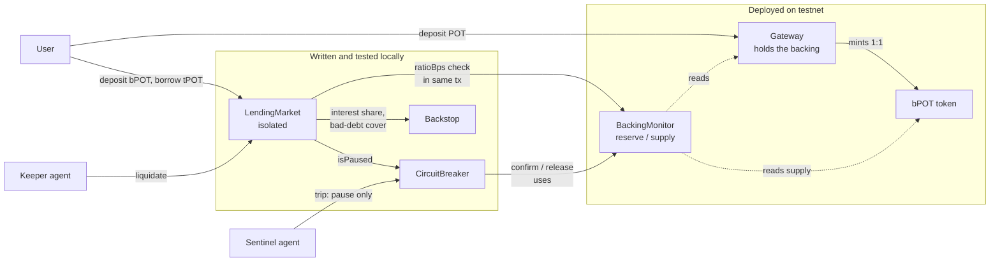

# DotProof

**Backing-aware lending on Portaldot.** Every loan is checked against proof that its collateral is actually backed, and a bonded agent network pauses the market the moment it isn't.

> Built for Portaldot Hacker House 2026 (Ecosystem DApps track). Unaudited hackathon prototype running on the V3 testnet. Testnet tokens have no value.

## The problem

Lending protocols judge collateral by market price and governance review, not by whether the collateral is still **backed**. In April 2026 an attacker forged a cross-chain message to the KelpDAO bridge, received 116,500 unbacked rsETH, deposited it on Aave as collateral and borrowed roughly $190M against it. Markets were frozen within hours, but the borrowing had already happened.

DotProof checks backing **on-chain, at the moment of the borrow**. If mint and borrow happen atomically in one transaction, no off-chain bot can stop them. Only a check inside the borrow transaction can.

## How it works

1. **Backing check at borrow.** `LendingMarket.borrow()` reads `BackingMonitor.ratioBps()` (reserve balance divided by token supply). Below the threshold the borrow reverts in the same transaction.
2. **Collateral seasoning.** Fresh collateral cannot back a loan for N blocks.
3. **Isolated markets.** One collateral asset per market. A breaker trip affects only that market.
4. **Circuit breaker that can only tighten.** A sentinel can trip a time-limited pause. Anyone can `confirm()` it into a hard pause when `BackingMonitor` proves under-backing, and anyone can `release()` it once backing is restored. Nobody, including the owner, can unpause by decree.
5. **Backstop.** A first-loss reserve funded by a share of interest covers bad debt before lenders take a loss.
6. **No price oracle.** Collateral (bPOT) and the borrow asset (native tPOT) are both POT-denominated, so collateral value is `amount x backing ratio`. Nothing external can be faked.

## Architecture



| Contract | Role | Status |
|---|---|---|
| `Gateway` | Mints bPOT 1:1 against native POT it holds, burns on withdrawal | Deployed |
| `BPOT` | Minimal hand-written ERC-20, only the Gateway can mint or burn | Deployed |
| `BackingMonitor` | Computes `reserve / supply` on-chain. Reusable by any token with a native reserve | Deployed |
| `LendingMarket` | Supply, borrow, repay, liquidate, caps, seasoning, utilization-based interest | Tested locally |
| `CircuitBreaker` | Per-market pause that agents can only tighten | Tested locally |
| `Backstop` | First-loss reserve, funded by interest | Tested locally |
| `WeakGateway` | **Exploit reproduction fixture. Not a production bridge.** | Tested locally |

### Exploit reproduction fixture

A correct wrapped token never goes unbacked, so a breaker would never fire. `contracts/contracts/fixtures/WeakGateway.sol` adds a deliberately weak privileged mint (`forgedMint`) that creates bPOT with no reserve, mirroring how the KelpDAO attacker minted unbacked tokens. It exists only so the monitor and breaker have something real to catch, and it is labelled as a fixture everywhere it appears.

## Live on Portaldot V3 testnet

Network: `PortaldotV3 Test`, EVM chain ID `420420777`, RPC `https://test-evm-rpc-v3.portaldot.dev`, node console `https://node-console.portaldot.dev/`.

| Contract | Address |
|---|---|
| Gateway | `0x619cA0F74Bbe92CaE32CA72920CbA0ff0E5aF370` |
| bPOT | `0xF8191413d53B750cE2F0BFc44722c0EBF0bF95A1` |
| BackingMonitor | `0x60A22c14e7c3353d5B26843c8eA1cFF5D12Ef589` |

| Transaction | Hash |
|---|---|
| Deploy Gateway (creates bPOT) | `0x2b6ea71cc1f2e36e5bd01ab240149b425af2f13fe0381105102b5f345ed06651` |
| Deploy BackingMonitor | `0x3eca706625c37f8308782f41c9b71d08256b1ab2e312e2e0163410854c804278` |
| Demo deposit, 1 tPOT minted as 1 bPOT | `0x8c0fd8f59613050537c223e881833c248735707e7af983d8bcfd23f53d978040` |

After the demo deposit, `BackingMonitor.ratioBps()` returns `10000` (100% backed), and the Gateway holds 1 tPOT of backing for 1 bPOT of supply. Addresses and hashes are also recorded in [`contracts/deployments/portaldot.json`](contracts/deployments/portaldot.json).

### Findings about the network (useful to other builders)

Measured against the live chain while building:

- Portaldot V3 "EVM" runs on `pallet-revive`. The runtime constant `allowEVMBytecode` is `true`, so plain `solc` bytecode deploys directly through the eth RPC.
- `revive.depositPerByte` is 6e12, about **0.06 tPOT per byte of contract code**, plus a fixed per-contract deposit. A dry-run quote for the full 7-contract protocol is roughly 1,000 tPOT. This is why only a three-contract slice is deployed so far, and why bytecode size drove several design choices (a hand-written ERC-20, the reserve merged into the Gateway).
- `revive.nativeToEthRatio` is 10000, so native tPOT with 14 decimals appears as 18 decimals on the EVM side. The contracts assume 1e18 per tPOT.

## Project status

| Item | State |
|---|---|
| Gateway, bPOT, BackingMonitor on testnet with real tx hashes | Done |
| LendingMarket, CircuitBreaker, Backstop, exploit fixture | Written, 18 passing tests, **not yet deployed** (needs more testnet tPOT for code deposits) |
| Frontend (landing page, markets, agents, app shell) | Built. **All data is placeholder** until wired to the contracts |
| AgentRegistry (bonds, slashing), MarketFactory | Not started |
| Sentinel and Keeper agents running against real RPC data | Not started |

## Run it

### Contracts

```bash
cd contracts
npm install
npx hardhat test                      # 18 tests, local Hardhat chain
```

Deploy the check-in slice to the testnet. Put a funded testnet-only key in a git-ignored `.env` at the repo root as `DEPLOYER_KEY=...`, then:

```bash
DRY_RUN=1 npx hardhat run scripts/deploy-slice.js --network portaldot   # cost estimate, sends nothing
npx hardhat run scripts/deploy-slice.js --network portaldot             # real deployment
```

The script refuses to run if the key does not belong to the expected deployer address.

### Frontend

```bash
cd web
npm install
npm run dev          # http://localhost:3000
```

Do not run `npm run build` while `npm run dev` is running, because both write to `.next`.

## What the tests cover

- Mint and redeem 1:1 with a 100% backing ratio, and the ratio dropping after a forged mint.
- Seasoning blocks an immediate borrow, then allows it. LTV limit, interest accrual, repayment, lender withdrawal with interest, caps.
- Liquidation with bonus, and bad debt covered by the backstop before lenders.
- **The KelpDAO pattern:** an attacker forges 1,000 unbacked tokens, deposits them and tries to borrow. The borrow reverts with `BackingBelowThreshold(909)` in the same transaction, even before seasoning ends.
- The breaker pauses only the affected market, tightens the liquidation threshold, can be confirmed by anyone when backing is provably low, and can only be released once backing is restored.

## Honest trust model

- Where the backing lives on this chain (the Gateway's own balance), the check is trustless and fully on-chain.
- For assets whose reserves live on another chain, the design relies on Sentinel agent attestation. That is a trust assumption, not a trustless proof. It is meant to be bonded and limited, and that part is not built yet.
- Agents are rule-based by default. An LLM may assist a Sentinel on borderline cases but would never have authority over safety-critical paths. The value of the agent framing is accountability and autonomy (own wallet, bond, hard limits), not that an LLM is required.
- This is an unaudited prototype. It has no liquidity, audits or battle-testing, and price-oracle coverage is intentionally out of scope.

## Dependencies and licences

| Dependency | Use | Licence |
|---|---|---|
| OpenZeppelin Contracts 5.x | `Ownable`, `ReentrancyGuard`, `SafeERC20`, `IERC20` | MIT |
| Hardhat and hardhat-toolbox | Build, test, deploy | MIT |
| Next.js, React, Tailwind CSS | Frontend | MIT |

The Aave design-system tokens used as visual reference for the frontend come from a public, MIT-licensed extraction. The layout is adapted, not copied, and no Aave assets or branding are used. Core code was written during the build window (Oct 14 to Nov 6, 2026).

## Repository layout

```
contracts/      Solidity contracts, tests, deploy scripts, deployments/
web/            Next.js frontend
```

## Licence

MIT
